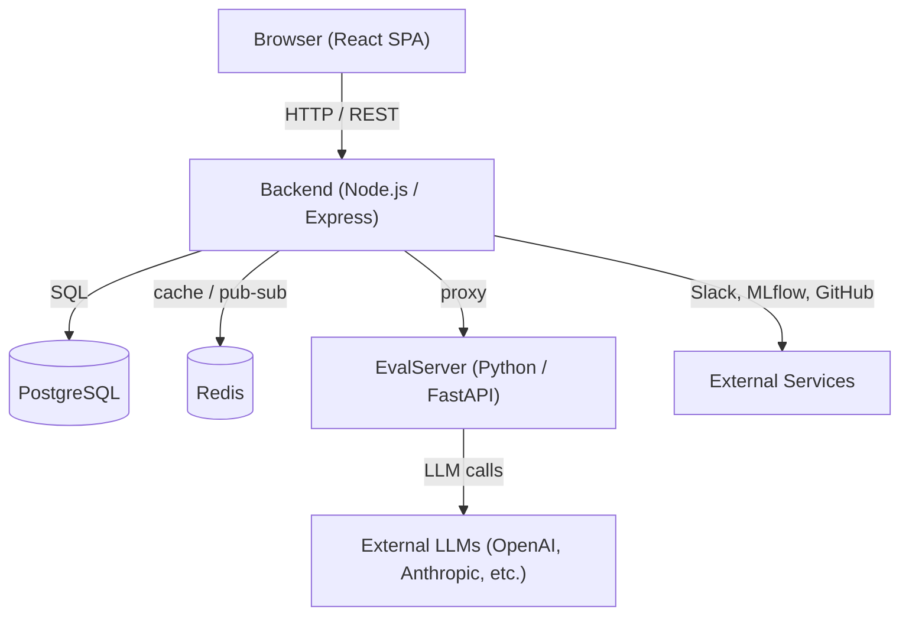

# Aegis.AI — Project Overview

## What Is It?

**Aegis.AI** is an open-source (BSL 1.1) **AI Governance Platform** designed to help businesses use AI safely and responsibly. It enables compliance with major AI regulations and standards, and can be self-hosted (on-premises or private cloud).

---

## High-Level Architecture

The platform is divided into **4 major components**:

| Component | Location | Language / Framework | Port |
|-----------|----------|---------------------|------|
| **Frontend (Client)** | `Clients/` | TypeScript + React 18 + Vite | 5173 |
| **Backend (Server)** | `Servers/` | TypeScript + Node.js + Express | 3000 |
| **EvalServer** | `EvalServer/` | Python + FastAPI | 8000 |
| **EvaluationModule** | `EvaluationModule/` | Python (standalone) | N/A |

---

## Component Deep-Dive

### 1. Frontend — `Clients/`

- **Framework**: React 18, Vite, TypeScript
- **UI Library**: Material UI (MUI v7)
- **State Management**: Redux + Redux Persist + TanStack React Query
- **Routing**: React Router DOM v7
- **Rich Text**: Plate.js + TipTap + Monaco Editor
- **Charts / Viz**: Recharts, MUI X-Charts, Plotly, XY Flow (node graphs)
- **File Uploads**: Uppy

**Clean Architecture layers inside `Clients/src/`:**

| Layer | Directory | Purpose |
|-------|-----------|---------|
| Domain | `domain/` | Core business types & entities |
| Application | `application/` | Hooks, contexts, Redux store, use-case logic |
| Infrastructure | `infrastructure/` | API calls via `customAxios` |
| Presentation | `presentation/` | Pages, components, themes, styles |

Key entry point: `Clients/src/App.tsx` — sets up routing via `createRoutes()`, Redux Provider, MUI theme, onboarding modal, a command palette (⌘K), and a User Guide sidebar.

---

### 2. Backend — `Servers/`

- **Framework**: Express.js, TypeScript
- **ORM**: Sequelize + Sequelize TypeScript (PostgreSQL via `pg`)
- **Auth**: JWT (`jsonwebtoken` + `passport-jwt`), Google OAuth2, Entra ID
- **Caching / Queues**: Redis (`ioredis`) + BullMQ (background jobs)
- **Email**: Nodemailer, MJML templates, AWS SES, Azure Email, Resend
- **AI**: OpenAI SDK, Anthropic SDK (for AI Advisor)
- **Logging**: Winston
- **Docs**: Swagger UI at `/api/docs`
- **Security**: Helmet, express-rate-limit, bcrypt, express-validator

**Key route groups exposed at `/api/...`:**

- `users`, `roles`, `organizations` — Auth & RBAC
- `projects`, `projectRisks`, `risk-change-history` — Use-case & risk management
- `vendors`, `vendorRisks`, `vendor-risk-change-history` — Vendor management
- `eu-ai-act`, `iso-42001`, `iso-27001`, `nist-ai-rmf` — Compliance frameworks
- `modelInventory`, `modelInventoryHistory`, `modelRisks` — AI model registry
- `policies`, `policy-change-history` — Policy management
- `tasks`, `ai-incident-managements` — Task & incident tracking
- `evidenceHub`, `ce-marking`, `aiTrustCentre` — Evidence & trust center
- `automations`, `integrations/mlflow`, `integrations/github`, `slackWebhooks` — Integrations & automations
- `deepeval`, `evaluation-llm-keys` — LLM evaluation (proxied to EvalServer)
- `advisor` — AI-powered governance chatbot
- `ai-detection` — Code repository AI content scanning
- `notifications`, `entity-graph`, `approval-workflows` — Misc platform features

**Database**: Sequelize migrations in `Servers/database/migrations/` (163 migration files). Redis used for notifications pub/sub and job queues.

---

### 3. EvalServer — `EvalServer/`

- **Framework**: FastAPI (Python 3.12)
- **Purpose**: Handles all LLM evaluation workloads (benchmarks, arena comparisons, experiment tracking)
- **Routers**: `/deepeval`, `/deepeval_projects`, `/deepeval_orgs`, `/deepeval_arena`, `/evaluation_logs`
- **DB Migrations**: Alembic
- **Caching**: Redis

The Node.js backend proxies deepeval requests to this service, injecting API keys from the database before forwarding them.

---

### 4. EvaluationModule — `EvaluationModule/`

- A standalone Python library/CLI for bias & fairness evaluation
- Contains `BiasAndFairnessModule/`, `scorers/`, `data/`, `configs/`
- Uses `deepeval` framework for metric scoring

---

## Key Platform Features

- **Compliance frameworks**: EU AI Act, ISO 42001, ISO 27001, NIST AI RMF; risk & control mappings
- **Dashboard**: Executive and operating views
- **AI Model Inventory**: Registry of models in use, associated risks, change history
- **Vendor Management**: Vendors, vendor risks, and change history
- **Policy Manager**: Create/manage internal AI policies with linked objects
- **LLM Evals & Arena**: Run LLM evaluation experiments, compare models side-by-side
- **AI Advisor**: LLM-powered governance chatbot
- **AI Detection Module**: Scans code repositories to detect AI-generated content
- **Evidence Hub & CE Marking Registry**
- **AI Trust Center**: Public-facing transparency page
- **AI Literacy Training Registry**
- **AI Incident Management**
- **Automations**: Trigger actions on entity changes, periodic reports, or webhooks
- **Integrations**: Slack, MLflow, GitHub
- **Approval Workflows**: Multi-step approval for policies/risks
- **Entity Change History**: Full audit trail for every major entity
- **Event Logs**: Audit logging for enterprises
- **Reports**: PDF and DOCX export
- **RBAC**: Fine-grained role-based access control
- **Email**: Multiple providers (AWS SES, Office 365, SMTP, Resend)
- **Onboarding**: Setup modal and guided onboarding for new users
- **Command Palette** (⌘K / Ctrl+K)

---

## Deployment

| Mode | How |
|------|-----|
| **Development** | `npm run watch` (Server) + `npm run dev` (Client) + `python app.py` (EvalServer) |
| **Production (Docker)** | `docker-compose --env-file .env.prod up -d` |
| **Kubernetes** | Manifests in `kubernetes/` |
| **SSL** | Nginx reverse proxy + Certbot |

**Required ports**: 5173 (frontend), 3000 (backend), 5432 (PostgreSQL), 6379 (Redis), 8000 (EvalServer)

---

## Important Files

| File | Purpose |
|------|---------|
| [README.md](file:///d:/aegis-develop/README.md) | Full installation & feature guide |
| [Servers/index.ts](file:///d:/aegis-develop/Servers/index.ts) | Express app entry, all route registrations |
| [Clients/src/App.tsx](file:///d:/aegis-develop/Clients/src/App.tsx) | React app root, routing, providers |
| [EvaluationModule/app.py](file:///d:/aegis-develop/EvaluationModule/app.py) | FastAPI EvalServer entry |
| [docker-compose.yml](file:///d:/aegis-develop/docker-compose.yml) | Dev Docker Compose |
| [Servers/swagger.yaml](file:///d:/aegis-develop/Servers/swagger.yaml) | Full API docs (97 KB) |
| [.env.dev](file:///d:/aegis-develop/.env.dev) | Dev environment template |
| [Clean_Architecture.md](file:///d:/aegis-develop/Clean_Architecture.md) | Architecture decisions |
